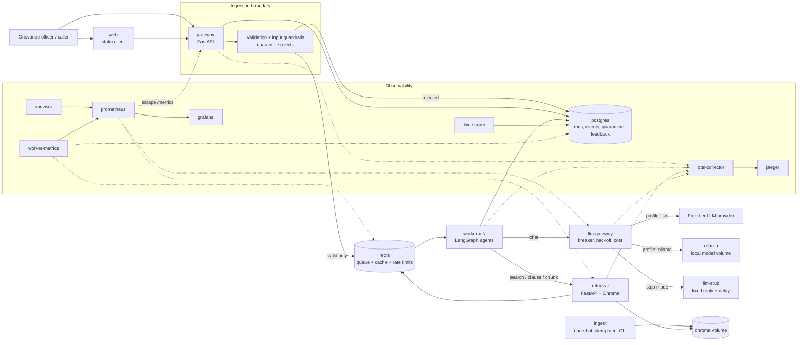

# ORCAS — Project Report

**Orchestrated Regulatory Complaint Analysis & Routing System**  
Team: Mitesh (agent core & LLM layer) · Tahir (data, retrieval & quality) · Jignas (platform & reliability)  
Repository: https://github.com/Mitxh13/orcas

---

## 1. Problem and Scope

Retail investors write free-text complaints to SEBI about brokers, mutual funds, registrars, listed companies, and depositories. Many of these complaints do not belong to SEBI. A bank fixed-deposit grievance falls under the **RBI Integrated Ombudsman Scheme 2021**, even when the complainant addresses it to SEBI and uses investment vocabulary.

A single retrieval pass on such a complaint retrieves SEBI's grievance framework — the wrong answer. The core problem is **jurisdictional classification under regulatory cross-reference**: a provision in one framework can redirect a complaint to a different regulator, and the redirecting provision can only be found after reading the initially retrieved evidence and searching again.

**Scope of the system:**

- Accepts a free-text investor complaint via REST API.
- Decides which regulator (SEBI or RBI) and which regulated entity is responsible.
- Produces a *routing determination* with verified, circular-level citations.
- Escalates to a human reviewer when it cannot be sure — it never guesses.
- Never submits anything to a real regulator portal. Never *disposes* of a complaint.

**Reference case (must always pass):**
> *"I invested in a fixed deposit through my bank's app. The interest credited is lower than what I was promised. I want to complain to SEBI."*  
> Expected: **refer-to-other-regulator → RBI Integrated Ombudsman Scheme 2021**, with citations that resolve to retrieved text (preamble + clause 9).

---

## 2. Agent Design

### 2.1 Topology

Two independent agents run sequentially inside a single Celery task:

```
Complaint text
     │
     ▼
┌─────────────────────────────────────────────────────┐
│  Researcher Agent  (LangGraph StateGraph)            │
│  normalize → classify → [plan → tool → reflect]* → draft │
└─────────────────────────────┬───────────────────────┘
                              │  draft + evidence_ledger
                              ▼
┌─────────────────────────────────────────────────────┐
│  Verifier Agent  (independent class, read-only)      │
│  ledger check → quote check → scope-card guard       │
│  → LLM grounding gate → consistency invariants       │
└─────────────────────────────┬───────────────────────┘
                              │
                              ▼
                    Output guardrail filter
                              │
                              ▼
                    Determination stored in Postgres
```

The Researcher explores the corpus through a bounded tool-calling loop. The Verifier uses a *read-only* retrieval client (only `get_chunk`; no search) and independently audits the draft. Neither agent shares mutable state.

### 2.2 Tools

| Agent | Tool | Purpose |
|---|---|---|
| Researcher | `search_corpus(query, framework, entity_type, k)` | Dense + filter retrieval across SEBI & RBI corpora |
| Researcher | `get_clause(doc_id, clause_id)` | Exact single-clause lookup for cross-referencing |
| Researcher | `get_complaint_fields(fields)` | Inspect structured complaint metadata |
| Researcher | `list_framework_scope(framework)` | Fetch scope cards (finding aids, not citable evidence) |
| Verifier | `get_chunk(chunk_id, quote_span)` | Resolve SHA-pinned chunk to audit verbatim substrings |

The Verifier cannot call `search_corpus`. Separation is enforced by wrapping the retrieval client in a `_ReadOnlyRetrievalClient` that exposes only `get_chunk`.

### 2.3 Verification (5-layer gate)

1. **Ledger containment** — every citation's `chunk_id` must exist in the evidence ledger retrieved *during this run*. Chunks from previous runs or invented IDs are rejected.
2. **Quote span integrity** — `quote_span` must be ≥ 20 characters and must appear verbatim (or whitespace-normalised) in the chunk text.
3. **Scope-card rejection** — `chunk_type=scope_card` chunks are finding aids, not citable authority. Rejected unconditionally.
4. **LLM grounding gate** — the Verifier prompt checks each sentence in `basis` against the retrieved passages. Output defaults to `passed=False` unless the LLM explicitly justifies acceptance.
5. **Consistency invariants** — `refer_to_other_regulator` requires at least one retrieved passage from the target regulator's framework; `assign_to_entity` requires SEBI evidence; `timeline.days` must appear in the basis-citation text, otherwise the timeline is dropped and noted.

### 2.4 Loop limits

All bounds are read from environment variables; none are hard-coded:

| Parameter | Env var | Default | Rationale |
|---|---|---|---|
| Step limit | `MAX_STEPS` | 10 | Prevents infinite re-planning |
| Tool call budget | `MAX_TOOL_CALLS` | 8 | Caps retrieval overhead |
| Wall-clock limit | `RUN_WALL_CLOCK_S` | 45 s | Terminates well below Celery soft timeout |
| Verification retries | `MAX_VERIFY_RETRIES` | 2 | Allows strategy rotation |
| Celery soft timeout | `CELERY_SOFT_TIME_LIMIT` | 120 s | Graceful degradation before kill |
| Celery hard timeout | `CELERY_TIME_LIMIT` | 180 s | Hard kill |

The wall-clock check runs before every LLM call and before every tool call. Budget exhaustion produces an `escalated` determination with `reason_code=budget_exhausted`, not a crash.

---

## 3. Architecture Diagram



**Deployment boundaries:**

| Service | Why separate |
|---|---|
| **gateway** | Latency-sensitive intake; must stay up when agents are slow or crashing |
| **worker** | Long-running, I/O-bound; scaled independently with `--scale worker=N` |
| **retrieval** | Owns the embedding model and vector index (hundreds of MB); re-indexable without touching agents |
| **llm-gateway** | Only service holding provider credentials; circuit-breaker state shared across all workers via Redis |
| **llm-stub** | Test isolation; same API as live upstream; load tests measure ORCAS, not provider rate limits |
| **redis** | Ephemeral: queue, cache, rate limits, circuit-breaker state |
| **postgres** | Durable: runs, events, quarantine, feedback, verification scores |
| **worker-metrics** | Read-only metrics adapter; queries Postgres and Redis for run KPIs without embedding an HTTP server in Celery |
| **worker-scheduler** | Dispatches a stale-run sweep every minute; escalates runs stuck in `running` |
| **live-scorer** | Scores a sampled fraction of completed runs; writes to `eval_scores` for Grafana charting |

---

## 4. Design Decisions and What Was Rejected

### 4.1 Agent architecture — two separate agents, not one

**Decision:** Researcher and Verifier are separate classes with separate LLM clients and separate retrieval permissions, connected through an explicit hand-off contract (`draft` + `evidence_ledger`).

**Rejected:** a single agent that researches and self-verifies. Self-verification is structurally prone to confirming its own reasoning. An independent verifier with a read-only client cannot introduce evidence the Researcher did not retrieve.

### 4.2 Retrieval — clause-aligned chunking, not fixed-window

**Decision:** Regex clause/CHAPTER-aligned segmentation. Each chunk carries a real `clause_id`, `heading_path`, and inferred `entity_types`. Long clauses are split into `#k` sub-chunks. Scope cards (one per framework) are finding aids whose `source_clause_chunk_id` points to the citable clause.

**Rejected:** fixed-window chunking. Benchmark showed fixed-window achieved recall@5 = 1.00 on 6 topical probes vs clause-aligned's 0.833, but the difference is an artefact of larger windows that trivially contain more phrases. The mean hit score favoured clause-aligned (0.719 vs 0.650), and the RBI grounds provision retrieved at 0.809 vs ~0.63 with fixed-window. More importantly, clause-aligned produces citable, addressable provisions that verification needs.

**Rejected:** hybrid retrieval (dense + BM25 + RRF). Showed no measurable recall gain on this corpus; available via `mode` parameter but off by default.

### 4.3 LLM failure — fail-closed, no heuristic fallback

**Decision:** any failure to reach the LLM gateway (non-200, timeout, connection refused) raises a typed `LLMUnavailable` exception. The pipeline catches it and produces an `escalated` determination with `degraded=true`. The Verifier path also fails closed: an unverified draft is never returned as a completed answer.

**Rejected:** a local keyword-matching heuristic fallback. Early versions had one. It caused tests to pass while masking real connection errors, and produced answers that could not be verified against retrieved text. Deleted entirely.

### 4.4 Prompt versioning — YAML artifacts, single-pass loader

**Decision:** prompts are YAML files (`prompts/<name>/<version>.yaml`) loaded by a `PromptLoader` with single-pass regex interpolation. Variable names are validated before interpolation; the prompt body is never re-parsed after substitution (prevents prompt injection through complaint text).

**Rejected:** f-string templates in code. No versioning, no prompt-injection isolation, no audit trail.

### 4.5 Toxicity guardrail — word-boundary matching

**Decision:** `\b`-anchored regex patterns for each toxic word.

**Rejected:** substring matching. The word `die` as a substring incorrectly flagged `bodies`, `remedies`, `studied`. Word boundaries prevent false positives without requiring a model-based classifier.

### 4.6 Cost accounting — env-driven list prices, no model names in code

**Decision:** `LLM_PRICE_INPUT_PER_M` and `LLM_PRICE_OUTPUT_PER_M` are read from the environment. The accounting function never references a model name. Every LLM call event stores prompt tokens, completion tokens, and cost; Prometheus exposes `orcas_run_cost_by_step_usd`.

**Rejected:** hard-coded per-model price tables. These become stale, can expose model selection decisions in source code, and do not accommodate custom or local models.

---

## 5. Evaluation Results — Before and After

### 5.1 Retrieval benchmark (before/after chunking strategy)

6 topical probes, framework-filtered:

| Strategy | recall@5 | recall@10 | mean_hit_score |
|---|---|---|---|
| Fixed-window / dense | 1.000 | 1.000 | 0.650 |
| **Clause-aligned / dense (shipped)** | **0.833** | **0.833** | **0.719** |
| Clause-aligned / hybrid | 0.833 | 0.833 | n/a |

Clause-aligned trades a marginal raw-recall dip for sharper ranking and citable provisions.

### 5.2 Agent evaluation — stub mode (25 synthetic scenarios, 2026-11-12)

The agent (`eval/agent_sut.py`) with stub replies. Deterministic embedding (NLI-substitute) judge; thresholds: support 0.45, relevance 0.32, infer 0.40. 7 scenarios held out from tuning.

| Metric | All (25) | Held-out (7) |
|---|---|---|
| Answered (not escalated) | 18 | 4 |
| Groundedness / faithfulness | 1.000 / 1.000 | 1.000 / 1.000 |
| Context relevance | 0.561 | 0.450 |
| Hallucination rate | 0.000 | 0.000 |
| Route / regulator / entity accuracy | 0.720 / 0.720 / 0.680 | 0.429 / 0.429 / 0.429 |
| Escalation precision / recall | 0.714 / 0.500 | 0.333 / 0.333 |
| Supporting passage retrieved / cited | 0.133 / 0.000 | 0.000 / 0.000 |
| Intake rejection recall / false rejections | 1.000 / 0 | 1.000 / 0 |

> **Note:** stub replies are canned, so these numbers describe the pipeline structure, not model quality. Groundedness and faithfulness are 1.000 because the stub answer's single generic sentence aligns with the retrieved passage. No live-model evaluation has been run.

**Keyword baseline (reference only, `make eval-baseline`):** groundedness 0.722, context relevance 0.900, faithfulness 0.833, hallucination 0.278, supporting passage retrieved 0.333. The agent eliminates hallucination at the cost of lower context relevance in stub mode.

### 5.3 Load test: before and after the stub routing fix

The stub's narrow parsing caused many premature escalations in the first benchmark (10 clients, 1 worker, 1.5 s stub delay). After commit `3a64fc6` hardened classification and routing:

| Metric | Before (first benchmark) | After |
|---|---|---|
| Ten-client p95 | 40 s | **30 s** |
| Completed / escalated in DB window | 101 / 263 | **245 / 136** |
| LLM calls per terminal run | ~3.2 | 3.010 |
| Three-worker ten-client p95 | 20 s | **11 s** |
| First SLO breach (p95 > 90 s) | 40 clients, p95 123 s | 40 clients, p95 104 s |

---

## 6. Performance Results: p95 Target, Measured Results, Bottleneck, and Cost

### 6.1 SLO target (declared before first load test)

At ten concurrent clients, p95 submit-to-terminal latency ≤ **90 seconds** and ≥ **99%** of accepted runs reach `completed` or `escalated`.  
Workload: 1.5-second LLM stub, one worker container, two Celery processes, 100+ complete complaints after warmup.


### 6.2 Measured results


| Workload | Workers | Clients | Observations | p50 | p95 | Throughput | Failures |
|---|---:|---:|---:|---:|---:|---:|---:|
| Baseline | 1 | 10 | 380 | 22 s | **30 s** | 0.417/s | 0 |
| Scaled | 3 | 10 | 1,076 | 8.2 s | **11 s** | 1.186/s | 0 |
| Higher load | 1 | 20 | 144 | 46 s | 52 s | 0.414/s | 0 |
| Higher load | 1 | 40 | 164 | 94 s | **104 s** ❌ | 0.418/s | 0 |

**SLO result:** ✅ Passed at 10 clients (p95 = 30 s, 100% terminal success). First breach at 40 clients (p95 = 104 s).

**Cache effect:**

| Cache mode | p50 | p95 | Throughput | LLM calls |
|---|---|---|---|---|
| Repeated input after warmup | 0.081 s | 0.13 s | 9.110/s | 0 |
| Same input, bypass enabled | 23 s | 31 s | 0.383/s | 255 |

Warm cache p95 is ~238× lower than bypassed. 1,638 cache-hit events recorded in the repeat window.

### 6.3 Bottleneck

At 40 clients: worker CPU reached 81.03%, gateway 35.23%, Postgres 37.42%, retrieval 3.59% (sampled maxima under Docker's per-core convention). Queue depth peaked at 38 tasks at 40 clients (mean 30.9). Scaling from 1 to 3 workers halved p95 (30 s → 11 s) and nearly tripled throughput (0.417 → 1.186/s). The evidence points to **limited worker execution slots** (each worker container runs two Celery processes) as the primary bottleneck, not host CPU exhaustion.

### 6.4 Cost per 100 runs

The stub returns $0 per LLM call. At ~3.0 LLM calls per terminal run, **stub cost = $0 per 100 runs**. This is a test-environment figure. The bypass window used 293,199 tokens for 76 runs (~3,860 tokens/run). Live-model cost per 100 runs is unmeasured until a provider is configured; it must be derived from the persisted `orcas_run_cost_by_step_usd` Prometheus series.

---

## 7. What Did Not Work

1. **Silent heuristic fallback.** Early `LLMClient` fell back to keyword-matching when the gateway was unreachable. Tests passed while masking real errors; heuristic answers could not be verified. *Fixed:* `LLMUnavailable` exception, fail-closed escalation. See incident log 2026-11-03.

2. **Hard-coded entity branches in Researcher.** A Python `if "bank"` check redirected bank complaints to RBI regardless of agent reasoning, making the reference case pass for the wrong reason. *Fixed:* removed all hard-coded branches; framework swaps are driven by `researcher_reflect/v2.yaml` reading the retrieved evidence.

3. **Substring toxicity matching.** The word `die` flagged legitimate financial text containing `bodies`, `remedies`, `studied`. *Fixed:* `\b`-anchored regex patterns; added explicit unit tests for false-positive words.

4. **Hash replication in small LLMs.** Requiring models to copy 64-character SHA-256 chunk IDs caused truncated hashes and unnecessary escalations. *Fixed:* numbered evidence tags `[E1]…[En]` with deterministic code-level resolution (`researcher_draft/v2.yaml`).

5. **Stub skewed the first benchmark.** Narrow stub classification triggered premature escalations; 101 completed vs 263 escalated in the first 10-client run. *Fixed:* hardened stub parsing (commit `3a64fc6`); second run: 245 completed vs 136 escalated.

6. **First evaluation never scored the agent.** `make eval` ran only the keyword baseline; groundedness (0.911) was inflated because claims were sentences copied from retrieved passages. *Fixed:* harness now scores the agent SUT; claims come from the answer's own text.

7. **Automated corpus download blocked.** Firecrawl ran out of credits; the RBI document host WAF-blocks `curl`. Documents were fetched via browser and provenance recorded in `corpus/MANIFEST.yaml`.

8. **Celery task unregistered in Compose smoke.** A broad `ImportError` handler in worker tracing suppressed a FastAPI instrumentation failure before the task decorator ran. Run stayed `queued`. *Fixed:* conditional instrumentation loading; unexpected worker import errors now fail startup. See incident log 2026-10-27.

---

## 8. References

- **Corpus:** `corpus/MANIFEST.yaml` (SHA-256-pinned documents, source URLs, versions)
- **SLO:** [`docs/slo.md`](../slo.md)
- **Runbook:** [`docs/runbook.md`](../runbook.md)
- **Incident log:** [`docs/incident_log.md`](../incident_log.md)
- **Architecture:** [`docs/ARCHITECTURE.md`](../ARCHITECTURE.md)
- **Evaluation set:** `eval/scenarios.yaml` (25 scenarios, 7 held out)
- **Load test results:** `loadtest/results/ci/summary.json`
- **Detailed report sections:** [`docs/work/mitesh/report-sections.md`](../work/mitesh/report-sections.md) · [`docs/work/tahir/report-sections.md`](../work/tahir/report-sections.md) · [`docs/work/jignas/report-sections.md`](../work/jignas/report-sections.md)
