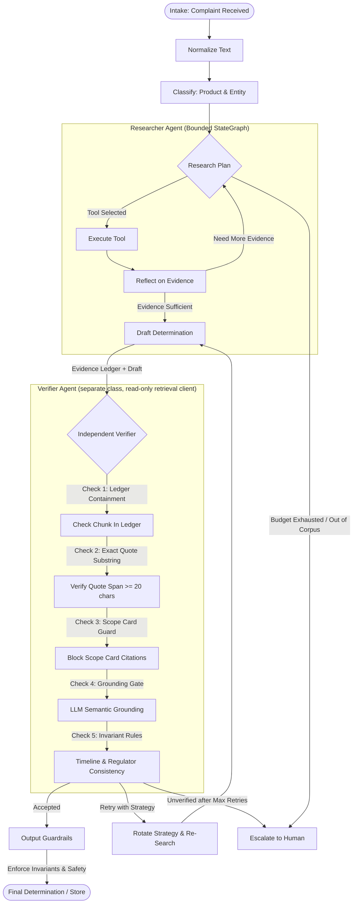

# Agent Core Architecture & Implementation Report
**Author:** Mitesh (Agent Core & LLM Infrastructure Lead)  
**Deliverable:** Sections for the Project Final Report & Architecture Chapter  
**Scope:** `services/worker/`, `services/llm_gateway/`, `services/llm_stub/`, `prompts/`, `tests/agent/`

---

## 1. Agent Topology & System Architecture

ORCAS employs a multi-agent topology combining a goal-oriented **Researcher Agent** and an independent **Verifier Agent**, orchestrated within a bounded LangGraph pipeline.

### 1.1 Structural Topology

---

## 2. Tools & The Agent Hand-off Contract

### 2.1 Tool Execution & Permissions
To enforce strict separation of duties (Requirement A2):
- **Researcher Agent:** Has permission to search and explore:
  - `search_corpus(query, framework, entity_type, k)`: dense/keyword retrieval across SEBI & RBI corpora.
  - `get_clause(doc_id, clause_id)`: precise single-clause lookup for statutory cross-referencing.
  - `get_complaint_fields(fields)`: inspects structured complaint metadata.
  - `list_framework_scope(framework)`: fetches finding-aid scope cards for SEBI or RBI.
- **Verifier Agent:** Restricted strictly to read-only chunk verification:
  - `get_chunk(chunk_id, quote_span)`: resolves SHA-pinned chunk content to audit verbatim substrings.
  - Cannot execute arbitrary searches or manipulate the evidence ledger.

### 2.2 The Hand-Off Contract (ARCHITECTURE §4.1)
The Researcher hands off to the Verifier:
1. `draft`: Candidate determination containing route, regulator, entity type, timeline, basis, and circular-level citations.
2. `evidence_ledger`: The complete ordered list of passages retrieved during the research phase (`chunk_id`, `text`, `doc_id`, `clause_id`, `query_used`, `step`).
3. `classification`: Extracted product, entity, and stated regulator.

The Verifier returns:
- `decision`: `"accept"`, `"retry"`, or `"escalate"`.
- `passed`: Boolean.
- `claims_checked` & `claims_supported`: Counts derived from the LLM claim-checking audit.
- `suggested_strategy`: Next remediation strategy if a retry is indicated.

---

## 3. The Independent Verification Algorithm

Verification is a strict 5-layer gate that prevents hallucinated citations and unsupported legal claims:

1. **Evidence Ledger Containment Check:** Every citation's `chunk_id` in the draft must exist within the evidence ledger retrieved during *this specific run*. Unretrieved chunks are rejected.
2. **Quote Span Integrity:** Every citation must contain a `quote_span` of at least 20 characters that matches verbatim (or whitespace-normalized) within the chunk text. Empty or truncated quotes are blocked.
3. **Scope-Card Rejection:** Finding aids (`chunk_type="scope_card"`) cannot be cited as substantive legal authority; citations must resolve to statutory clauses.
4. **LLM Semantic Grounding Gate:** The Verifier prompt parses each sentence in `basis`, extracts legal assertions, and validates that each assertion is factually supported by the retrieved passages. Default output defaults to `passed=False` unless explicitly justified.
5. **Timeline & Cross-Framework Consistency:**
   - If `timeline.days` is asserted (e.g., 30 days), the integer value must appear in the basis citation passage; otherwise, the timeline is dropped and noted in basis.
   - `refer_to_other_regulator` requires evidence from the destination framework (e.g., RBI Integrated Ombudsman Scheme 2021).
   - `assign_to_entity` requires SEBI evidence and an authorized SEBI entity type.

---

## 4. Loop Limits & Execution Bounds (Requirement A1)

All bounds are configurable via environment variables and strictly audited before every LLM and tool invocation:

| Parameter | Environment Variable | Default Value | Rationale |
|---|---|---|---|
| Step Limit | `MAX_STEPS` | 10 | Prevents infinite re-planning loops |
| Tool Call Budget | `MAX_TOOL_CALLS` | 8 | Caps embedding and vector search overhead |
| Wall-Clock Limit | `RUN_WALL_CLOCK_S` | 45.0s | Enforces termination well below Celery soft timeout |
| Verification Retries | `MAX_VERIFY_RETRIES`| 2 | Allows strategy rotation without latency inflation |
| Celery Soft Timeout| `CELERY_SOFT_TIME_LIMIT` | 120s | Allows graceful degradation before process kill |
| Celery Hard Timeout| `CELERY_TIME_LIMIT` | 180s | Hard process kill limit |

---

## 5. Failure Behaviour & Degradation Matrix (ARCHITECTURE §4.3)

| Failure Mode | Immediate Action | Resulting Status | Regulator | `degraded` Flag |
|---|---|---|---|---|
| Researcher LLM / Timeout | Catch `LLMUnavailable`, abort research | `escalated` (`agent_failure`) | `UNDETERMINED` | `true` |
| Verifier Unavailable | Never return unverified draft | `escalated` (`verification_unavailable`) | As drafted | `true` |
| Retrieval error, soft time limit or any other exception | Close the run at once; keep the draft's citations as partial findings | `escalated` (`agent_failure`) | As drafted, else `UNDETERMINED` | `true` |
| Primary Gateway Trip | Breaker opens; invoke `LLM_FALLBACK_MODEL` | `completed` or `escalated` | As determined | `true` |
| All LLM Retries Failed | Gateway returns HTTP 503 | `escalated` (`agent_failure`) | `UNDETERMINED` | `true` |
| Out of Corpus Entity | Classify triggers early escalation | `escalated` (`out_of_corpus`) | `UNDETERMINED` | `false` |
| Split Regulators | Dual jurisdiction detected (RBI + SEBI) | `escalated` (`split_regulators`) | `UNDETERMINED` | `false` |
| Guardrail Prohibited Language | Filter converts output to escalation | `escalated` (`guardrail`) | Allowed enum | `false` |
| Worker Process Killed | Celery `acks_late=True` redelivers task | Re-run or escalated | As determined | Preserved |

---

## 6. Prompt Versioning & L2 Comparison (Requirements L2, M13)

Prompts are decoupled from code and loaded via `PromptLoader` with single-pass regex interpolation:

- `researcher_classify/v1.yaml` vs `v2.yaml`:
  - `v1` attempted hard-coded heuristic jurisdiction guidance inside the prompt.
  - `v2` isolates product extraction, removes premature jurisdiction rules, and captures `stated_regulator` for true §4.1 framework swapping.
- `researcher_draft/v1.yaml` vs `v2.yaml`:
  - `v1` dumped raw JSON ledgers with 64-character hashes, leading to frequent hallucination of chunk IDs.
  - `v2` presents numbered evidence items `[E1]...[En]` with ≤25-word quote spans, eliminating hash hallucinations.
- `researcher_reflect/v1.yaml` vs `v2.yaml`:
  - `v2` enables active modifier hunting across frameworks.

- `researcher_classify/v3.yaml` is v2 plus `regulators_involved`, the field split-regulator escalation
  reads. It is the default.

### Prompt Comparison Summary
No comparison on a live model has been run yet, so there is no measured result to report here. The two
comparisons are pre-registered in `eval/experiments.yaml` (`l2-reflect-prompt`: reflect v1 against v2;
`l3-cite-by-evidence-number`: draft v1 against v2) with their hypotheses and primary metrics, and
`make experiment NAME=<name>` runs each. In stub mode draft v1 and v2 give identical outcomes on all 25
scenarios, which shows the evidence-number mapping works end to end and says nothing about model quality.

---

## 7. Cost Accounting & Largest Cost Drivers (Requirements L5, M14)

Cost is calculated per-call in `services/llm_gateway/accounting.py` using equivalent list prices configurable via environment variables (`LLM_PRICE_INPUT_PER_M`, `LLM_PRICE_OUTPUT_PER_M`):

1. **Equivalent list pricing:** a free-tier or local model bills nothing, so each call is costed at the
   list prices set in the environment. Both default to 0; no model or price is fixed in the repository.
2. **Where the figures come from:** every `llm_call` run event stores prompt tokens, completion tokens and
   cost for its step. The metrics exporter publishes them as `orcas_run_tokens_by_step` and
   `orcas_run_cost_by_step_usd`, and the "LLM tokens and cost by step" dashboard panel shows the split.
3. **Measured so far:** stub mode only, where a run makes 3.2 LLM calls on average (25 evaluation
   scenarios, 2026-11-12) and cost is zero. The share of tokens per step and the cost per 100 runs
   depend on the model and are to be filled in from the live-model run.

---

## 8. What Didn't Work (Engineering Retrospective & Post-Mortem)

1. **Silent Heuristic Fallback:**  
   *What happened:* Early versions of `LLMClient` fell back to a keyword-matching heuristic when the LLM gateway was unavailable. This caused tests to pass artificially while masking underlying connection errors.  
   *Correction:* Deleted all heuristic code paths. Failure to connect now cleanly raises `LLMUnavailable`, converting the run into an honest `escalated` outcome with `degraded=true`.
2. **Hard-coded Branching for Reference Cases:**  
   *What happened:* A hard-coded python check redirected bank complaints to RBI regardless of agent reasoning.  
   *Correction:* Removed all hard-coded entity branches. Framework swaps are now driven dynamically by `researcher_reflect/v2.yaml` observing the gap between SEBI scope and the bank deposit product.
3. **Substring Matching in Toxicity Guardrail:**  
   *What happened:* A substring check for `"die"` in `OutputFilter` caused legitimate financial texts containing `"bodies"` or `"remedies"` to be falsely flagged as toxic.  
   *Correction:* Switched to strict `\b` regex word boundaries and added explicit unit tests for "bodies", "remedies", "studied", and "skill".
4. **Hash Replication in Small LLMs:**  
   *What happened:* Requiring smaller or quantized models to copy 64-character SHA-256 chunk IDs resulted in truncated hashes and unnecessary escalations.  
   *Correction:* Numbered evidence tags (`[E1]...[En]`) with deterministic code-level resolution.
